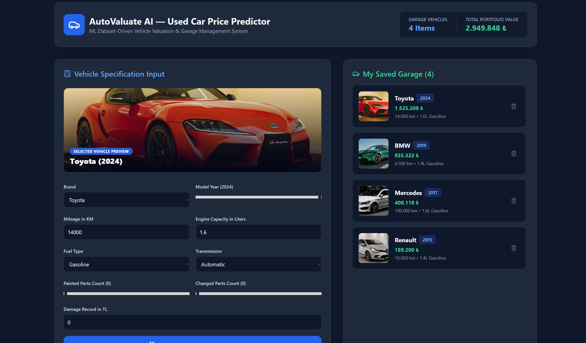

# 🚗 AutoValuate AI — Used Car Price Predictor & Garage Management

AutoValuate AI is a modern, responsive web application built with React, Vite, and Tailwind CSS. The application estimates second-hand car market valuations based on parameters derived from a machine learning dataset (`used_car_price_dataset.csv`) and manages user vehicle portfolios using browser-based `LocalStorage`.

---

## 📸 Application Preview



---

## 🚀 Live Demo & Repository

- **Live Web Application:** [https://used-car-price-web.vercel.app](https://used-car-price-web.vercel.app)
- **GitHub Repository (Public):** [https://github.com/umutkacar16/used-car-price-web](https://github.com/umutkacar16/used-car-price-web)

---

## 🛠️ Tech Stack & Libraries

- **Frontend Framework:** React 18 (via Vite)
- **Styling & UI:** Tailwind CSS (Dark Mode Interface)
- **Icon Set:** Lucide React (`lucide-react`)
- **State & Data Storage:** HTML5 `LocalStorage` for client-side persistence
- **Deployment Platform:** Vercel

---

## 🤖 Artificial Intelligence (AI) Integration & Prompts

During the development process, AI assistants (Gemini, ChatGPT, and Cursor) were integrated into every phase of software construction:

1. **Dataset Analysis & Valuation Modeling:** 
   - Analyzed numerical correlations and non-linear feature distributions (`brand`, `model_year`, `mileage_km`, `engine_capacity`, `fuel_type`, `transmission`, `damage_record_tl`, `painted_parts`, `changed_parts`) from `used_car_price_dataset.csv`.
   - Transformed OLS regression and tree-based ensemble metrics (XGBoost $R^2 = 0.9718$) into a lightweight JavaScript client-side valuation engine (`carPredictor.js`).

2. **Component Architecture & UI Engineering:**
   - Designed responsive grid layouts, custom input ranges, dynamic form resets, and interactive preview cards using tailored Tailwind CSS prompts.

3. **LocalStorage Synchronization:**
   - Implemented reactive hooks to handle real-time garage array updates, portfolio net worth summation, and item deletions.

4. **Debugging & Refactoring:**
   - Resolved PostCSS `@import` directive conflicts between Tailwind CSS v3 and v4 and optimized image object alignment (`object-cover` / `object-center`).

---

## 💻 Local Installation & Setup Guide

Follow these steps to run the project locally on your machine:

### Prerequisites
- Node.js (v18.0.0 or higher recommended)
- npm (v9.0.0 or higher)

### Installation Steps

1. **Clone the Repository:**
   ```bash
   git clone [https://github.com/umutkacar16/used-car-price-web.git](https://github.com/umutkacar16/used-car-price-web.git)
   cd used-car-price-web